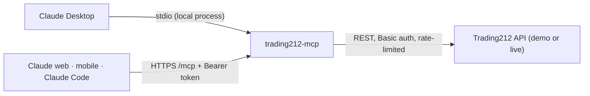

# trading212-mcp

[](https://github.com/sziatko/trading212-mcp/actions/workflows/ci.yml)
[](https://github.com/sziatko/trading212-mcp/releases/latest)
[](LICENSE)


An [MCP](https://modelcontextprotocol.io) server that connects Claude to your
[Trading212](https://www.trading212.com) account. You can ask about cash, positions, orders, pies,
dividends and transactions in plain language. If you turn on the write tools, Claude can also place
and cancel orders and manage pies, and you approve each of those calls yourself.

You can run it in two ways:

- **Locally, as a Claude Desktop extension.** One-click `.mcpb` install over stdio. No terminal and
  no Node.js needed.
- **Remotely, over Streamable HTTP.** Deploy it once (a [Render](https://render.com) Blueprint is
  included) and use it from Claude on desktop, web, mobile, and in Claude Code.

[](https://render.com/deploy?repo=https://github.com/sziatko/trading212-mcp)

## Highlights

- **22 tools.** 13 read tools cover the account, positions, orders, history, pies and metadata.
  9 write tools cover orders and pies.
- **Safe defaults.** It uses your demo account unless you switch to live. Write tools are off unless
  you turn them on.
- **You always know which account you're in.** Every tool description and every response starts
  with `🧪 DEMO` or `🔴 LIVE`.
- **Approval before any change.** Write tools are annotated `readOnlyHint: false`, so Claude asks
  you before each call. `cancel_order` and `delete_pie` are also marked `destructiveHint: true`.
- **Built-in rate limiting.** Each Trading212 endpoint has its own documented limit. The client
  waits for a free slot, so normal use doesn't hit `429`.
- **Locked-down HTTP mode.** The server won't start without a bearer token. Tokens are compared in
  constant time and never logged.
- **100% test coverage**, with CI on every push.

## What you can ask

> What's my portfolio worth right now, and how much is profit?
>
> Which of my positions are down more than 10%?
>
> How much did I get in dividends this year, broken down by ticker?
>
> Show my pies and how each one is allocated.
>
> Put a limit order to buy 2 shares of AAPL at 180, good till cancelled. *(write tools on)*

## How it works



The same tools are available in both modes. `TRANSPORT=http` switches the server from stdio to
Streamable HTTP. Nothing else changes.

## Contents

- [Get a Trading212 API key](#get-a-trading212-api-key)
- [Option 1: Claude Desktop extension (local)](#option-1-claude-desktop-extension-local)
- [Option 2: Remote server over HTTP (Render)](#option-2-remote-server-over-http-render)
- [Option 3: Run from source](#option-3-run-from-source)
- [Tools](#tools)
- [Configuration](#configuration)
- [Security](#security)
- [Development](#development)
- [Project structure](#project-structure)
- [Implementation notes](#implementation-notes)

## Get a Trading212 API key

1. In the Trading212 app, open **Settings → API** and generate a key. Give it only the permissions
   you need: read-only is enough unless you plan to use the write tools.
2. Trading212 gives you an **API key** and a **secret**. The server expects them joined as
   `key:secret` and base64-encoded:

   ```bash
   printf '%s' 'YOUR_KEY:YOUR_SECRET' | base64
   ```

Demo (practice) and live accounts have separate keys. The server uses only one of them at a time,
depending on `TRADING212_USE_LIVE`.

## Option 1: Claude Desktop extension (local)

1. **[Download trading212-mcp.mcpb](https://github.com/sziatko/trading212-mcp/releases/latest/download/trading212-mcp.mcpb)**
2. Double-click it, or drag it into the Claude Desktop window.
3. Claude Desktop asks for your API key(s) and whether to use the live or demo account. It also
   shows a switch for each tool category, including the write tools.

The server runs as a local process on your machine. It is only reachable from Claude Desktop.

> **Changing a setting needs a full Claude Desktop restart** (quit and reopen, not just a new
> chat). Claude Desktop passes settings as environment variables when it starts the server process,
> and a running process can't pick up new ones. See
> [Anthropic's docs](https://support.claude.com/en/articles/10949351-getting-started-with-local-mcp-servers-on-claude-desktop).

## Option 2: Remote server over HTTP (Render)

With `TRANSPORT=http`, the server runs a Streamable HTTP endpoint at `/mcp` and a health check at
`/healthz`. Deploy it once and add it to Claude as a custom connector. It then works in Claude on
desktop, web and mobile, and in Claude Code.

### 1. Generate an auth token

```bash
openssl rand -hex 32
```

Every request to `/mcp` must send `Authorization: Bearer <token>`. Anything else gets `401`. With
`TRANSPORT=http`, the server refuses to start if `MCP_AUTH_TOKEN` is not set.

### 2. Deploy

Click **Deploy to Render** at the top of this page, or in Render choose **New → Blueprint** and
point it at your fork. Render reads [`render.yaml`](render.yaml):

| Setting | Value |
| --- | --- |
| Runtime | Node (version from `engines` in `package.json`, `>=24`) |
| Build | `npm install && npm run build` |
| Start | `node dist/index.js` |
| Health check | `/healthz` |
| Plan | `free` |

Render asks for each environment variable. They are all `sync: false`, so no secret is stored in
the repo:

| Variable | Value |
| --- | --- |
| `TRANSPORT` | `http` (already set in `render.yaml`) |
| `MCP_AUTH_TOKEN` | the token from step 1 |
| `TRADING212_DEMO_API_KEY` / `TRADING212_API_KEY` | your key(s), see [above](#get-a-trading212-api-key) |
| `TRADING212_USE_LIVE` | `false` for demo (recommended to start), `true` for live |
| `ENABLE_*` toggles | optional, leave empty for the defaults |
| `ENABLE_ORDER_WRITE_TOOLS` / `ENABLE_PIE_WRITE_TOOLS` | leave empty or `false`, see [Security](#security) |

You don't need `PORT`. Render sets it, and the server listens on `0.0.0.0:$PORT`.

### 3. Check it's up

```bash
curl https://<your-service>.onrender.com/healthz
# OK
```

### 4. Connect Claude

**Claude (desktop, web, mobile):** go to **Settings → Connectors → Add custom connector**.

- URL: `https://<your-service>.onrender.com/mcp`
- Under **Request headers**, add the header `Authorization` with the value `Bearer <token>`.
  Claude sends the value exactly as you type it, so include the `Bearer ` prefix.

Static request headers on custom connectors are still a beta from Anthropic and may not be
enabled for every account yet. If you don't see **Request headers**, use Claude Code (below) until
your account gets it.

**Claude Code:**

```bash
claude mcp add --transport http trading212 https://<your-service>.onrender.com/mcp \
  --header "Authorization: Bearer <token>"
```

### Free tier cold starts

A free Render web service goes to sleep after about 15 minutes without traffic. The next request
wakes it up, which takes about 30–60 seconds. For personal use that's usually fine. If it bothers
you, switch to a paid instance or ping `/healthz` on a schedule.

### Other hosts

Render is optional. Any platform that runs Node 24 and gives you HTTPS will work (Railway, Fly.io,
a VPS behind a reverse proxy). Build with `npm run build`, start with `node dist/index.js`, and set
`TRANSPORT=http`, `MCP_AUTH_TOKEN` and your Trading212 key. `PORT` defaults to `3000`.

### Try it locally

```bash
npm install && npm run build
TRANSPORT=http MCP_AUTH_TOKEN=dev-token TRADING212_DEMO_API_KEY=<key> node dist/index.js

# in another terminal
curl -X POST http://localhost:3000/mcp \
  -H "Authorization: Bearer dev-token" \
  -H "Content-Type: application/json" \
  -H "Accept: application/json, text/event-stream" \
  -d '{"jsonrpc":"2.0","id":1,"method":"tools/list"}'
```

## Option 3: Run from source

```bash
git clone https://github.com/sziatko/trading212-mcp.git
cd trading212-mcp
npm install
npm run build
```

**Claude Desktop:** add the server to `claude_desktop_config.json`. Put the keys in the `env` block.
Claude Desktop starts the server from its own working directory, so a `.env` file in the repo won't
be picked up.

```json
{
  "mcpServers": {
    "trading212": {
      "command": "node",
      "args": ["/absolute/path/to/trading212-mcp/dist/index.js"],
      "env": {
        "TRADING212_DEMO_API_KEY": "<base64 key:secret>"
      }
    }
  }
}
```

**Claude Code:**

```bash
claude mcp add trading212 -e TRADING212_DEMO_API_KEY=<base64 key:secret> \
  -- node /absolute/path/to/trading212-mcp/dist/index.js
```

To work on the code, copy `.env.example` to `.env`, fill it in, and run `npm run dev` (`tsx`, no
build step).

## Tools

### Read tools

All of them are `readOnlyHint: true`. Each one belongs to a category that is on by default.

| Tool | Category | Parameters | Returns |
| --- | --- | --- | --- |
| `get_cash_balance` | account | none | Cash, invested, `ppl`/`result` (account profit/loss), pie cash, blocked funds. Uses the legacy `/equity/account/cash` endpoint because no documented endpoint has these fields. |
| `get_account_summary` | account | none | Cash, invested value, profit/loss, total value. |
| `get_positions` | positions | none | `{ positions: [...] }`, all open positions. |
| `get_position` | positions | `ticker` | `{ positions: [...] }` with 0 or 1 items. |
| `get_orders` | orders | none | `{ orders: [...] }`, all open/pending orders. |
| `get_order` | orders | `orderId` | One open/pending order. |
| `get_order_history` | orders | `cursor?`, `limit?` (1–50), `ticker?` | Filled/cancelled orders, `{ items, nextPagePath }`. |
| `get_dividends` | history | `cursor?`, `limit?` (1–50), `ticker?` | Dividend payments, `{ items, nextPagePath }`. |
| `get_transactions` | history | `limit?` (1–50), `cursor?` + `time?` (both or neither) | Deposits, withdrawals, transfers, `{ items, nextPagePath }`. |
| `get_pies` | pies | none | `{ pies: [...] }`: cash, dividends, result, status. |
| `get_pie` | pies | `pieId` | One pie with settings, holdings and allocation. |
| `get_instruments` | metadata | none | `{ instruments: [...] }`: tickers, names, ISINs, currencies. |
| `get_exchanges` | metadata | none | `{ exchanges: [...] }` with working schedules. |

Tickers use Trading212's own format, e.g. `AAPL_US_EQ`.

### Write tools

All of them are `readOnlyHint: false` and **off by default**. Order tools need
`ENABLE_ORDER_WRITE_TOOLS=true`, pie tools need `ENABLE_PIE_WRITE_TOOLS=true`. The matching read
category (`ENABLE_ORDERS_TOOLS` or `ENABLE_PIES_TOOLS`) has to stay on too.

| Tool | Parameters | Notes |
| --- | --- | --- |
| `place_market_order` | `ticker`, `quantity`, `extendedHours?` | Runs at the next available price. |
| `place_limit_order` | `ticker`, `quantity`, `limitPrice`, `timeValidity` | Runs at `limitPrice` or better. |
| `place_stop_order` | `ticker`, `quantity`, `stopPrice`, `timeValidity` | Becomes a market order at `stopPrice`. |
| `place_stop_limit_order` | `ticker`, `quantity`, `stopPrice`, `limitPrice`, `timeValidity` | Becomes a limit order at `stopPrice`. |
| `cancel_order` | `orderId` | `destructiveHint: true`. |
| `create_pie` | `name`, `instrumentShares?`, `goal?`, `dividendCashAction?`, `endDate?`, `icon?` | `instrumentShares`, e.g. `{"AAPL_US_EQ": 0.5, "MSFT_US_EQ": 0.5}`. |
| `update_pie` | `pieId` + the same fields as `create_pie` | |
| `delete_pie` | `pieId` | `destructiveHint: true`. |
| `duplicate_pie` | `pieId`, `name?`, `icon?` | |

A positive `quantity` buys and a negative one sells. `timeValidity` is `DAY` or `GOOD_TILL_CANCEL`.
Trading212 only executes orders in the account's main currency
([docs](https://docs.trading212.com/api/orders)).

## Configuration

In the Desktop extension these settings appear as a form. Everywhere else they are environment
variables (see [`.env.example`](.env.example)).

| Variable | Default | Description |
| --- | --- | --- |
| `TRADING212_DEMO_API_KEY` | none | Demo account credential (base64 `key:secret`). Used when `TRADING212_USE_LIVE` is not `true`. |
| `TRADING212_API_KEY` | none | Live account credential. Used only when `TRADING212_USE_LIVE=true`. |
| `TRADING212_USE_LIVE` | `false` | `true` switches to your real account. |
| `ENABLE_ACCOUNT_TOOLS` | `true` | Cash balance, account summary. |
| `ENABLE_POSITIONS_TOOLS` | `true` | Open positions. |
| `ENABLE_ORDERS_TOOLS` | `true` | Open orders, order history. |
| `ENABLE_HISTORY_TOOLS` | `true` | Dividends, transactions. |
| `ENABLE_PIES_TOOLS` | `true` | List/get pies. |
| `ENABLE_METADATA_TOOLS` | `true` | Instruments, exchanges. |
| `ENABLE_ORDER_WRITE_TOOLS` | `false` | Place/cancel orders. |
| `ENABLE_PIE_WRITE_TOOLS` | `false` | Create/update/delete/duplicate pies. |
| `TRANSPORT` | stdio | `http` starts the Streamable HTTP server. |
| `MCP_AUTH_TOKEN` | none | Bearer token for `/mcp`. **Required** with `TRANSPORT=http`. |
| `PORT` | `3000` | HTTP port. Render sets it for you. |

An unset or empty toggle uses its default. Otherwise it is on only when it is exactly `true`, and
any other value turns it off.

## Security

- **Demo first.** The default is the demo account, and every response is tagged `🧪 DEMO` or
  `🔴 LIVE`, so you can't confuse them.
- **Writes are opt-in and need approval.** Write tools aren't registered unless you enable them. Once
  enabled, Claude asks you before every call.
- **Keep write tools off on a remote server.** A public HTTPS endpoint is much more exposed than a
  local process only Claude Desktop can talk to. The code doesn't enforce this, but the defaults
  already keep them off.
- **HTTP auth.** The server won't start without `MCP_AUTH_TOKEN`. Tokens are compared in constant
  time, never logged, and never echoed back in errors.
- **No state between requests.** Each HTTP request gets a new MCP server and transport.
- **Least-privilege keys.** Trading212 keys can be limited to specific permissions. Give the key no
  more than you need.

## Development

```bash
npm test                    # unit tests (Vitest)
npm run test:coverage       # coverage report, currently 100% across the board
npm run test:integration    # every tool over real MCP stdio, against the Trading212 DEMO API
npm run test:integration -- --write   # also place/cancel demo orders and create/delete a demo pie
```

The integration test always forces `TRADING212_USE_LIVE=false`, so it can never touch a live
account. It needs `TRADING212_DEMO_API_KEY` in `.env`.

**Build the `.mcpb` extension yourself:**

```bash
npm install -g @anthropic-ai/mcpb
npm run package
```

This builds the project, installs production-only dependencies into a temp directory, and writes
`trading212-mcp.mcpb` to the repo root (see `scripts/package.sh` and `manifest.json`).

CI (`.github/workflows/ci.yml`) runs `npm ci`, the build and the tests on Node 24 for every push and
pull request.

## Project structure

```
src/
├── index.ts              Entrypoint: stdio by default, Streamable HTTP when TRANSPORT=http
├── server.ts             createMcpServer(): registers every enabled tool category
├── http.ts               HTTP transport: /healthz, bearer auth, stateless /mcp
├── api/
│   ├── client.ts         t212Get/Post/Delete: live/demo URL, Basic auth, rate limit, errors
│   └── types.ts          Zod schemas for Trading212 request/response shapes
├── rate-limit/
│   ├── rateLimiter.ts    In-memory sliding-window limiter
│   └── rateLimits.ts     Per-endpoint limits from Trading212's docs
└── tools/                One file per domain: account, positions, orders, history, pies, metadata
docs/trading212-openapi.yaml   Official Trading212 OpenAPI spec, kept for reference
scripts/                       .mcpb packaging, MCP integration test
manifest.json                  Claude Desktop extension manifest
render.yaml                    Render Blueprint for the HTTP deployment
```

## Implementation notes

**No `outputSchema` for now.** Every tool returns `structuredContent` next to the text `content`,
but no tool declares an `outputSchema`. The first versions did, built from the Zod schemas in
`src/api/types.ts`. However, `@modelcontextprotocol/sdk` generates JSON Schema draft-07, and Claude
Desktop's bundled client only accepts 2020-12, so every tool call failed with an "unsupported
dialect" error
([typescript-sdk#2532](https://github.com/modelcontextprotocol/typescript-sdk/issues/2532),
[claude-code#86142](https://github.com/anthropics/claude-code/issues/86142)). The Zod schemas remain
the source of truth and can be wired back once Claude Desktop ships the fixed client.

**Lists are wrapped.** MCP requires structured output to be an object, so tools that return a list
wrap it under a key: `{ "positions": [...] }`, not `[...]`.

**`get_cash_balance` uses an undocumented endpoint.** `/equity/account/cash` isn't in the official
spec, but it's the only source of account-level `ppl`/`result`. Its schema is based on observed
responses, not on the spec.

## License

[MIT](LICENSE)
